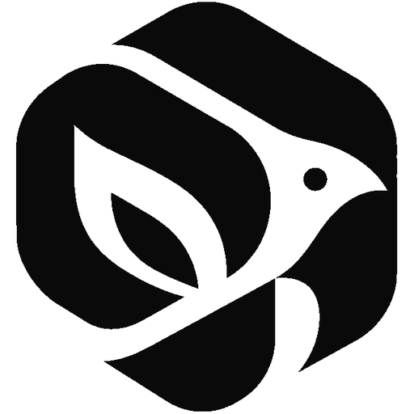
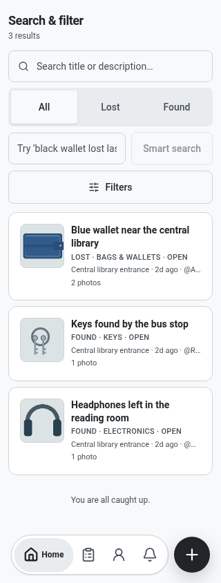
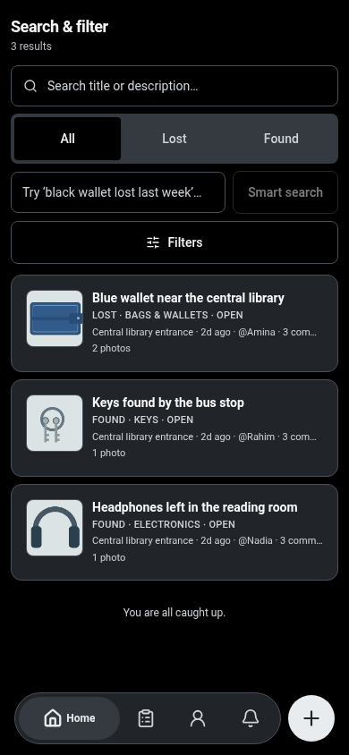

# Norfold

**Status: pre-public beta.** Install builds only from a published GitHub release.

Norfold (formerly FindBack) is a local-first lost-and-found network for reporting, matching and recovering lost items.

> **Website transition:** FindBack is now **Norfold**. The current production site remains [`findbackapp.social`](https://findbackapp.social) during the name transition. This address is scheduled to retire after a future Norfold domain is acquired and migration is ready. No replacement domain has been purchased or announced yet.

Lost something? Found something? Post it, and let people nearby help you get it back to its owner. A report works like a normal post: photos, a short description, a date and a spot on the map. Other people can comment, share it, or tell you they've seen the item. The app also suggests lost and found reports that look like each other, so you don't have to scroll through everything.

Web links to shared reports: <https://findbackapp.social>

## Screenshots

Browser captures with synthetic reports in light and true-black themes, from
an earlier beta (capture details are in the manifest). They predate later UI
changes and do not show the current build, a physical device or real accounts.

  
  

Capture dimensions and checksums: [screenshot manifest](docs/screenshots/manifest.json).

## How it works

1. **Post a report.** Say whether you lost something or found it. Add photos, describe it, pick a date and place.
2. **Look around.** Browse the feed, search with filters, or type a sentence like "black wallet lost near the gate" and let Smart Search turn it into filters.
3. **Check possible matches.** Open one of your reports to see lost and found reports that look similar.
4. **Get in touch and recover it.** Comment, share the report or send a message request. When the item is back with its owner, mark it as recovered. You can rate the person who helped.

## What's in the app

- Lost and found reports with photos, rich-text descriptions and map locations
- Feed and search, with several feed layouts to choose from
- Home, My Reports, Chats and Settings navigation; notifications in the bell and your profile under Settings
- Reports and People search, including public names and usernames
- Smart Search for plain-language queries
- Possible Matches between lost and found reports
- Comments with replies, mentions, photos, GIFs and links to other reports
- Likes, saved reports, sharing by link
- Notifications, including push
- Profiles with verification badges, successful returns and a reputation level
- Ratings that come from a real recovery, not from random profile visits
- Block, report and feedback tools
- Private messages with requests, connected-only still images, replies with quote jump-back, grouped photos, up to three shared pinned messages, one-time location sharing, report-linked contact, conversation search, mute and personal Archive
- Adaptive layouts: bottom navigation on phones, compact rails and split views on larger windows
- A shared photo viewer with zoom, keyboard navigation and desktop thumbnails
- Sign in with email or Google; phone verification is not enabled
- Six-digit email codes for signup confirmation and password recovery, with reset-link fallback; [provider SMTP and template setup](docs/auth/provider-setup.md) and real delivery verification are still required
- Optional AI Chat using your own API key from the provider you choose

This is a pre-public beta: the features above are implemented and working, but
behaviour can still change between releases.

## Your privacy

The full text is in the app under Settings: Privacy Policy, Terms and Community Guidelines. Short version of how the app is built:

- **Email and phone stay private.** Other users see your public profile (name, username, avatar, verification badges). They never see your email address or phone number.
- **Reports are visible to Norfold users.** Photos, descriptions, comments and locations you post can be seen by signed-in users. Eligible shared links show a minimal anonymous preview without raw report text, photos, contact details or location; full reports and private actions require sign-in. You can withdraw a preview. Don't post anything you wouldn't want a stranger to read, and blur addresses, papers, faces and serial numbers before adding a photo. The app reminds you of this while you write.
- **You choose how exact a location is.** You can pin an exact spot or an approximate one.
- **Smart Search and match suggestions run on your phone.** What you type into Smart Search is not sent to a cloud model.
- **AI Chat is separate and uses your own key.** Your key stays on your device. Messages you send in AI Chat go to the provider you picked, under that provider's terms, and charges depend on your account with them. Norfold does not run a server that relays them. Chat history is kept only while the app is open and is gone when you close it.
- **Private messages are separate from AI Chat.** Accepted history is stored on each device, with temporary server delivery and private image storage. Messages are not end-to-end encrypted. Push notifications wake the app rather than carrying message text. Optional encrypted Google Drive chat backup needs a separate Google consent in the web and Android apps (Android requires Google Play services) and is absent from builds that leave backup out. Backups are encrypted on the device, but the key is held for the account and re-issued to signed-in devices, so this is not zero-knowledge backup.
- **Chat location is a one-time choice, not live tracking.** Only connected conversations can send it. Review the exact or approximate pin before sending. Archive hides a conversation for you; it does not erase the other person's history.
- **You can delete your account** from Settings. That removes your account, reports and photos. Limited safety records are retained: reported-content evidence for up to 90 days, and appeal, moderation and audit records after deletion. Deletion cannot remove another person's existing copies of messages or files.
- **Staff tools are locked down.** Moderators and admins use the same app as everyone else. A privileged email offer requires normal verified account setup and explicit acceptance; signup alone never grants a role. The backend checks the role on every privileged action. Hiding a button is never the only protection.

## Safety

Meeting a stranger to hand over an item has real risks. Verify ownership before you hand something over: ask the owner for one detail that isn't in the post. If you find an ID or a card, keep one identifying detail out of the report so the real owner can prove it's theirs. Use the Report button on anything that looks like a scam, spam, harassment or stolen property.

## Install

Android is the primary target. Install only builds published on the GitHub
Releases page.

## Project status

The current source version is `0.16.0-beta.3`. The app works, and CI runs the
automated checks that cover its main flows. What is still unproven is behaviour
under real conditions: two accounts using the app together, one account signed in
on several devices, and physical Android hardware.

See [ROADMAP.md](ROADMAP.md) for direction.

## For developers

- Setup, stack, layout and checks: [docs/DEVELOPMENT.md](docs/DEVELOPMENT.md)
- Architecture and data flow: [docs/ARCHITECTURE.md](docs/ARCHITECTURE.md)
- Adaptive UI rules and current surfaces: [docs/DESIGN_SYSTEM.md](docs/DESIGN_SYSTEM.md)
- Canonical brand assets and cache/device acceptance: [BRANDING.md](BRANDING.md)
- Data model: [docs/erd/](docs/erd/)

## Contributing

See [CONTRIBUTING.md](CONTRIBUTING.md). Security problems go to
[SECURITY.md](SECURITY.md), never a public issue.

## License

Norfold is **source-available, not OSI open source**. It is licensed under the
[PolyForm Noncommercial License 1.0.0](LICENSE.md); commercial use needs a separate
written license ([COMMERCIAL.md](COMMERCIAL.md)). The Norfold name and branding are
reserved ([BRANDING.md](BRANDING.md)); third-party components keep their own licenses
([THIRD-PARTY-NOTICES.md](THIRD-PARTY-NOTICES.md)).

## Project origin

Norfold started in 2026 as a university course project and grew into a real
lost-and-found product. Course-era requirements, plans and evaluation material are
not the current product specification.
